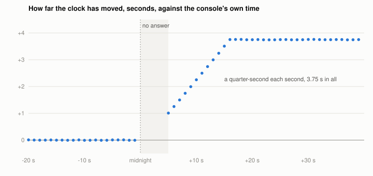
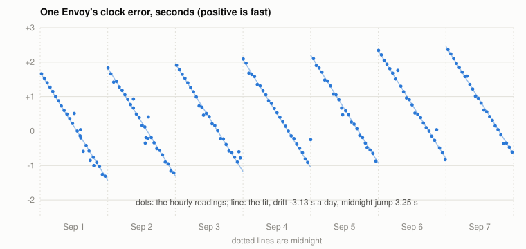
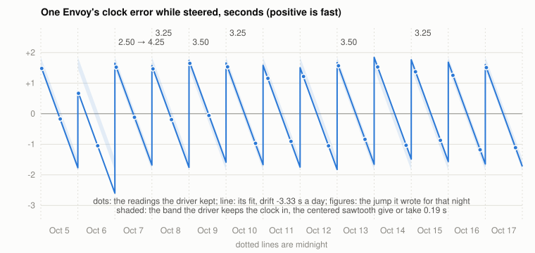
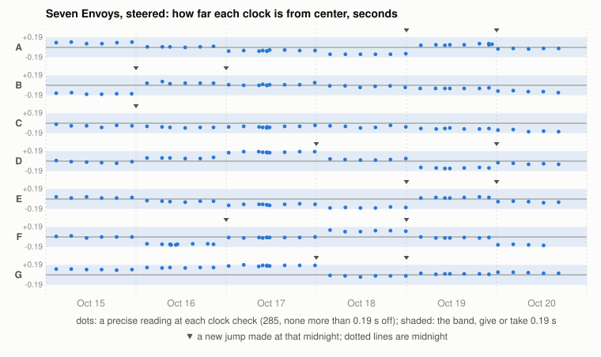
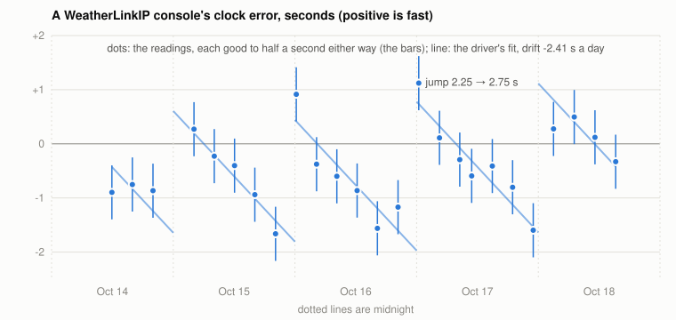

# Keeping the console clock

[weewx-vantagenext manual](https://chaunceygardiner.github.io/weewx-vantagenext/) ·
[weewx-vantagenext on GitHub](https://github.com/chaunceygardiner/weewx-vantagenext) ·
[Report an issue](https://github.com/chaunceygardiner/weewx-vantagenext/issues)

---

The console's clock matters because the console, not the computer, timestamps every archive
record.  Since 3.0 the driver keeps that clock **without setting it**, because every clock set
costs the console about a minute of its transmitter's packets.  It learns how the console's
clock behaves and steers the correction the console already makes to itself every midnight,
which costs nothing.  There is nothing to configure.  Since 3.3 a WeatherLinkIP is steered
too, from whole-second readings ([below](#a-weatherlinkip)).

## How a console's clock works

Measured on seven Davis Envoys and a Vantage Pro2 console, two things happen to a console's
clock every day.

**It loses time, steadily, all day.**  Between 2 and 4 seconds a day, depending on the
console, at a rate that does not change with the hour.  This is its **drift**.

**Just after midnight it corrects itself** by its **midnight jump**, a value it keeps in its
own memory (EEPROM address `0x2E`, in quarter-seconds).  The jump is not a step.  Measured
closely on the Vantage Pro2 console: for the first few seconds of the day the console does not
answer at all; then its clock runs fast, a quarter of a second every second, until the jump is
made.  A jump of 3.75 seconds takes about fifteen seconds:



The jump can be negative, and then the clock runs slow the same way, a quarter of a second
every second: measured at −1, −2, −3, −4 and −8 seconds.  The value can be rewritten at any
time, and the console uses the new one at its next midnight.

The jump comes from the factory, different from console to console, and it is the console's
own estimate of its drift: a console that loses 3 seconds a day ought to hold a jump of 3
seconds.  It is never exact, so most consoles gain or lose a little each day even after their
jump.

Together the two make the clock's error a **sawtooth**.  Here is a real Envoy for a week in
which nothing touched its clock:



Each day this console loses 3.13 seconds and each midnight it gains back 3.25, so the whole
sawtooth climbs 0.13 seconds a day (each figure rounded on its own, which is why they do not
quite add up).  That leftover — the drift plus the jump — is the
**creep**.  Before 3.0, the creep was what eventually called for a clock set.

**No clock that drifts can be right all day.**  The best on offer is a sawtooth *centered* on
zero, and its two extremes are both at midnight: a console that loses 3 seconds a day runs
from 1.5 seconds fast just after midnight to 1.5 seconds slow just before the next, and is
right only at noon.  How far the clock stands from that centered line is its **off-center**
distance.  It holds all day and changes at midnight by the creep.

Two more things matter to anyone keeping the clock:

- **A clock set moves it by a whole number of seconds.**  The command carries hours, minutes
  and seconds and nothing finer, and the console keeps its own sub-second tick across it.
- **It reports its time in whole seconds, truncated.**  One reading is therefore low by
  whatever fraction was dropped.  Polling until the second changes gives the error to a
  hundredth of a second or so on a serial connection: a **precise** reading.

## What a clock set costs

Every archive record carries `rxCheckPercent`: how many of the ISS's packets the console
received in that interval, against the number it should have.  A sound link runs at 98 to
100 percent, record after record.  On these consoles a low record means one of two things.

### A clock set

**Every clock set costs the console about a minute of its transmitter's packets.**  Of 51
clock sets measured across seven consoles, every one left the archive record it fell in short
of ISS packets: from ten seconds' worth to nearly three minutes', a minute or so typically.
The cost is the command, not the move.  On a spare console, a set to the very time
the console already showed stopped its live data for about a minute, and steps of two to
eight seconds no longer.  The console
lets go of its transmitter and takes a while to find it again, and three sets in four are
followed by a run of [truncated reads](recovery.md#when-read-errors-happen) while it does.

Reading the clock costs nothing measurable, and neither does rewriting the midnight jump.
That is why the driver steers the jump instead of setting the clock.

### Midnight

**With `archive_delay` set short, the console loses its transmitter just after midnight about
one night in fifteen**, for two to five minutes, occasionally longer.  This site ran WeeWX's
`archive_delay` at 3 seconds for two years, which puts the archive download a fraction of a
second after the console's [three-second silence at its own midnight](recovery.md#the-consoles-midnight),
inside whatever it is still finishing, and the archives show the loss every month at a steady
rate: each of the four consoles with an archive of its own since February lost 5 to 8 percent
of nights.  The record for the first five minutes of the day reads anywhere from about 60
percent down to almost nothing, with the records either side at 100.  It did not depend on the
weather, on the size of that night's jump, on whether WeeWX was restarted, or on what the other
consoles did that night, and clock sets are not the cause: the loss was the same on a console
whose clock was never set, and it went on after the driver stopped setting the clock.  On some
of those nights the console also stopped sending LOOP packets two to three minutes into the
day.  Moving the download to 6 seconds did not stop it, and one console that had its clock read
repeatedly across its midnight lost eight minutes.  At WeeWX's default of 15 seconds, twelve
seconds clear of the silence, it has not been seen on this site and has not been reported.
Leave `archive_delay` at its default.  Averaged over every night at 3 seconds the loss cost
about a dozen seconds of reception, and a low record at five past midnight is not a failing
link.

### How we know the loss is real

`rxCheckPercent` is the console's own count, and a clock set might upset the counting rather
than the reception.  Four things say the packets really are lost:

- **The other consoles heard them.**  Seven consoles at one site listen to the same ISS.  In
  the record where one of them was set, that console comes up short, and the other six, in the
  same five minutes, do not.  It is not the radio and it is not the weather.
- **Nothing else does it.**  Outside clock sets and midnight, only one record on any of the
  seven, in the archives examined, lost as much as a minute — and that was a test program
  fighting the driver for the serial port.
- **The live data stops.**  A spare console was run for days of controlled trials: in each
  five-minute record either nothing was done, or the clock was set, or the midnight jump was
  rewritten.  While the console hears its ISS, the wind in its LOOP packets changes every few
  packets: from any moment, the next change comes about 2 seconds later on average, and even a
  calm night never held it still for longer than half a minute.  After more than 300 clock
  sets the next change took about 55 seconds on average, and a minute or more after two sets
  in five.  After a rewrite of the midnight jump it took about 6 seconds, never once a minute,
  and where nothing was done, the same 2 seconds as always.  The console's own count told the
  same story: 60 to 90 seconds lost per set, 2 or 3 seconds per record otherwise.
- **At midnight, each console loses its own nights.**  On a night one console loses its
  transmitter, the others at the same site, hearing the same ISS, almost always do not.

## What the driver does

**It starts from the console's own estimate.**  The midnight jump the console came with is
its estimate of its drift, so the driver begins by assuming the jump cancels the drift
exactly, and changes nothing while it checks.

**It learns the drift.**  Twice a day — at the first clock check after ten past midnight, and
the first after six in the evening or earlier where the slot has to open sooner (below) — it
takes a precise reading, and fits a straight line
through the last 14 days of them, with the jumps and any sets it knows of taken out.  Until its
readings span half a day and a midnight it is **learning**: half a day to a little over a day,
depending on the hour WeeWX starts.  Its first decision comes on the first evening after that:
from under a day to a day and three quarters from the start.  (Behind a WeatherLinkIP it
learns for two days: [A WeatherLinkIP](#a-weatherlinkip).)

**Then it steers by the jump.**  Once a day, on the evening reading, it works out where
tonight's jump — a few hours off — would leave the clock:

- **Within 0.19 seconds of center:** it leaves the jump alone.
- **Further out:** it writes the quarter-second jump that brings the clock back, however far
  off it is, within the console's −8 to +8 seconds
  ([below](#a-clock-that-starts-off-center)).  On the day of a time change it allows for the
  day's real length, 23 or 25 hours:
  for a console that loses 3.3 seconds a day, an hour's drift is a seventh of a second.

A jump moves in quarter-seconds, so no choice can land the clock closer to center than an
eighth of a second, and few consoles drift by an exact quarter-second.  So the jump settles on
the two quarter-seconds either side of the console's drift, held a night or a few at a time:
a write about every other night at most, on average.  Each write costs nothing.  The band is
wide enough that a console whose drift falls midway between two quarter-seconds — creeping an
eighth of a second a night on either — switches about every other night, not every night.  A
console that gains
time gets a negative jump.

The clock's distance from center moves only at midnight, so the evening reading says what the
morning's did.  What deciding in the evening adds is everything learned since — a clock found
moved, a set, a sharper drift — which goes into tonight's jump.



The figure is a real console, an Envoy that loses 3.33 seconds a day, found holding a
2.50-second jump when the record opens: a creep of −0.83 seconds a day, and for two days the
sawtooth slides down while the driver learns the drift.  At its first decision it writes a jump
of 4.25 seconds — nearly a second more than the drift calls for, to pull the clock back — and
the next midnight brings the clock into the band.  From then on the jump moves between 3.25 and
3.50, the quarter-seconds either side of the drift, a night or a few at a time, and the clock
stays in the band.  The clock is never set.

Some guards:

- **Nothing is decided in the first ten minutes of the day**, while the jump may still be in
  progress, **nor in the last minute before it** (a console ahead of the computer begins its
  jump a few seconds early), **nor inside a [time change window](dst.md)**.  No jump is
  written from half past eleven at night until midnight, so a new value never lands as the
  console rolls over — except the one put back after a clock set, up to a minute before
  midnight ([The backstop](#the-backstop)).
- **Every jump written is read back**, and the driver reads the console's jump again before
  every reading it keeps, so it always acts on the jump the console holds.  A write it could not
  confirm — the read-back failed, the console's answer to the write was lost, or WeeWX
  stopped in the moment after it — is checked then: found in the console, it was written, and
  it counts as no failure.  A reading is taken only on a jump the driver has read: if the
  console's jump cannot be read, the next clock check tries again.
- **Two writes in a row that fail, or don't read back as written,** and the driver falls
  back to setting the clock (below).
- **A moved clock is found at the next reading the driver keeps.**  The console makes the jump it holds,
  every midnight, so the driver can predict each reading from the ones before it.  A reading
  more than 1.5 seconds from that prediction means something moved the clock, and the driver
  starts learning afresh from it.  It is tested against the readings *before* it, so a move
  of two seconds is found even in the first days, when a line drawn through only a few
  readings would bend toward the new one.  Before there is a line at all — while it is
  still learning — each line drawn is asked the same of itself: one that misses
  any of its own readings by more than 1.5 seconds, or says the console drifts more than
  8 seconds a day (or, falling back with the jump to learn too, that it jumps outside −8 to
  +8), holds a move, and learning starts again.  A
  power loss can leave the clock anywhere, seconds or months off; the size makes no
  difference.
- **The decision needs a precise reading** (on a serial or USB console: a WeatherLinkIP
  decides from the line through its readings, [below](#a-weatherlinkip)).  The driver decides
  on the first clock check from six in the evening — or from earlier, so that one `clock_check` always falls between the
  slot opening and half past eleven, or the start of a [time change window](dst.md) that
  evening, as Chile has — and only if it can catch the console's second ticking over to within
  a quarter of a second, which pins the clock to a hundredth of a second or so (a
  [precise reading](#how-a-consoles-clock-works)).  A console slow to
  answer gives only a whole-second reading, good to half a second, too rough to choose a
  quarter-second jump; the driver then waits for the next clock check and tries again, and a
  day whose every evening check reads that way keeps its jump one more night.  (A serial or
  USB console reads to a few hundredths of a second, every time, so this is a check that
  waits, not one that gives up.)  With a `clock_check` near the limit, about 23 hours, the
  slot opens as the ten minutes after midnight end, and the day's one reading is the
  decision.  Longer than that is warned at startup: days would pass with no check at all.

**It keeps what it learns** in `vantagenext/clock.json`, in WeeWX's archive directory
(`~/weewx-data/archive/vantagenext/clock.json` for a pip install,
`/var/lib/weewx/vantagenext/clock.json` for a package install).  A restart resumes where it
left off.

## A clock that starts off center

The driver never sets a clock it is steering, short of the `max_drift` backstop, so a console
that comes to it off center is brought in by the jump.  That is the case for nearly every
console the driver meets for the first time: WeeWX's built-in driver lets the clock wander up
to `max_drift`, 5 seconds, from the computer's time, and centers nothing.

**The first decision brings it in, in one night.**  It writes the quarter-second jump that
lands the clock nearest center, however far off it is, and that midnight puts it in the band
steering keeps.  The distance comes from a precise reading, good to a few hundredths of a
second, of where the clock is, so a jump several seconds from the drift is as safe as one a
quarter-second from it.  The
first decision is made from under a day to a day and three quarters after WeeWX starts.
Behind a WeatherLinkIP it comes about two days in, or as soon as there is a line for a clock
more than a second off, and a clock within a second of center is brought in over a few nights
([A WeatherLinkIP](#a-weatherlinkip)).  While
it learns, the console keeps the jump it came with, so each midnight moves the clock by however
far that jump is from the console's real drift: nothing to speak of for a console whose jump
matches its drift, 0.61 seconds a night for the one in the figure above.

For example, a console that loses 3.66 seconds a day and is 2.3 seconds fast of center at its
first decision gets a jump of 1.25 seconds, not the 3.66 that would only cancel its drift, and
that midnight lands it at −0.11.  The next evening's decision goes back to 3.75, the
quarter-second nearest its drift.

A jump can be no larger than 8 seconds either way, so a clock too far off for one to make up
takes more than one night.  With WeeWX's default `max_drift` of 5, a clock that far off is past
it at the widest of its day, for any console that drifts less than 6 seconds a day, so the
backstop sets it first if a clock check lands there.

**Until that first night, the clock's daily extremes are wider by its distance from center.**
That console, 2.3 seconds off center, is about 4.1 seconds fast just after midnight instead of
1.8.  The backstop compares the clock with the computer's time at every clock check: a check
that finds it more than `max_drift` out sets it to center at once
([The backstop](#the-backstop)).  So a clock off center by more than about `max_drift` less
half its drift — 3.2 seconds, for that console — can be set by the backstop before the first
jump the driver chooses has been made, and so can one somewhat closer if the jump it holds is
far from its drift: each midnight while the driver learns then carries it further out.  The
set can come while the driver learns, if a clock check lands near the clock's widest, or at
any check from the one that makes the first decision until that night's midnight, while the
clock is still going out and the jump that brings it in is yet to come.  Set while the driver
learns, the console keeps its jump and the first decision brings the clock the rest of the
way in; set once the driver has decided, it is left holding the jump that only cancels the
drift, so that night's jump does not correct it again.  A clock the backstop does not reach
is brought in by the first decision.

## What to expect

- **The clock is never set** in normal running.  Every night's correction is the console's
  own, steered by a value that costs nothing to change.
- **Its error stays within about half the drift of the true time, either way.**  For a console
  that loses 3 seconds a day: about 1.5 seconds fast just after midnight, about 1.5 seconds slow
  just before it, and right around noon.  Steering keeps the sawtooth within about a fifth of a
  second of center, so the extremes reach about 1.7 seconds.  Behind a
  [WeatherLinkIP](#a-weatherlinkip), read only to the second, the band is wider and the
  sawtooth sits some tenths further from center.  That is the floor for any console that
  drifts, and nothing can do better without setting the clock all day.
- **A clock that starts off center is brought in on the first night the driver steers**, after
  the day or so of learning (over a few nights, behind a WeatherLinkIP): [A clock that starts off center](#a-clock-that-starts-off-center).
- **WeeWX's `Clock error` line will show those extremes**, every night, and that is normal: the
  error is largest on either side of midnight by design.
- **The jump changes every day or few**, between the two quarter-seconds either side of the
  drift; behind a WeatherLinkIP, four to seven times a month.  Each change is a line in the
  log.
- **The console's memory will outlast the console.**  The driver writes only a jump that
  differs from the one held, about every other night at most on average: under 200 writes a
  year.  A
  Vantage Pro2 console keeps its settings in the EEPROM built into its microcontroller, an
  Atmel ATmega128L, which is rated for 100,000 writes: at that rate, more than 500 years.
- **The midnight loss is a matter of `archive_delay`, not of steering.**  Steering removes
  the cost of clock sets; the console's loss of its transmitter after midnight came with a
  short `archive_delay`, and at WeeWX's default it [has not been seen](#midnight).
- **The backstop never fires** on a console being steered.  It is there for a console whose
  clock something else has moved, and for one so far off center at the start that the backstop
  reaches it before the first jump the driver chooses has been made
  ([A clock that starts off center](#a-clock-that-starts-off-center)).

Here is a whole site: seven Envoys, each with its own drift and its own jump, and a precise
reading at every clock check since 15 October 2026, the first night every jump in force was
one an evening decision had chosen:



In 285 readings from 15 to 20 October no clock was more than 0.19 seconds from center, and none
was set.  The markers in each row are the midnights that console made a new jump.

## When something changes

The driver recovers by itself from anything that changes the console or its clock:

| What happened | What the driver does |
|---|---|
| WeeWX restarted, or the computer rebooted | Resumes from `clock.json` where it left off — including a jump it wrote just before and had not yet confirmed: found in the console, it is taken as written. |
| `clock.json` deleted or lost | Starts learning afresh from the jump the console holds — the best starting point there is.  It costs up to a day and three quarters before the first decision (two days to two and three quarters, behind a WeatherLinkIP), nothing more. |
| The console replaced by another | Sees a jump in the console other than the one it last held, at startup or at the next reading, and learns the console afresh.  If a new console happens to hold the same jump, the first reading the old drift cannot explain does the same (below). |
| The clock moved — a power loss, a set by hand, another program on the cable | A clock off by more than `max_drift` is set at once by [the backstop](#the-backstop).  Then, or for any smaller move, **a reading that the drift cannot explain by 1.5 seconds** shows the clock was moved — or, while the driver is still learning, a line that cannot explain its own readings — and the driver starts learning afresh from that reading.  How far it moved makes no difference: seconds or months.  A move the backstop did not set back is steered out by the [decisions that follow](#a-clock-that-starts-off-center): the first one after the learning, if the move caused any. |
| The console moved between serial or USB and ethernet, either way | Learns it afresh: whole-second readings and precise ones are not mixed ([A WeatherLinkIP](#a-weatherlinkip)). |
| The jump cannot be steered — its memory holds no valid jump, or writes fail | Falls back to keeping the clock by setting it ([below](#when-the-driver-falls-back-to-setting-the-clock)). |

To make the driver start over yourself — after it has fallen back, say — stop WeeWX, delete
`vantagenext/clock.json` from the archive directory, and start it again.  The console's jump
stays as the driver left it, which is the best starting point there is.

## Which consoles

Steering rests on what a console does with the jump in its memory, so this is where it has
been seen:

- **Steered:** a Vantage Pro2 console with firmware 3.88 (Oct 29 2019), and seven Envoys, six
  with firmware 3.88 (Nov 12 2019) and one with 3.83 (Jan 22 2018).  Jumps written to them
  were made at the next midnight with no other command: the 3.83 Envoy's went from 3.00 to
  3.25 seconds, and was measured at 3.25 the next night.  On the Vantage Pro2, negative and
  zero jumps were made too, and writing one cost it no reception.
- **Behind a WeatherLinkIP:** a console steered through one since October 2026.  A jump
  written through the logger reads back as written and is made at the next midnight: the
  first one written, 2.75 seconds in place of 2.25, moved the fitted clock the extra half
  second the next day, and the next evening's decision kept it.  The second, 2.25 in place of
  2.75, was made at its next midnight the same way.
- **Not yet seen:** a Vantage Vue, an original Vantage Pro, and any other firmware.

The driver does not take any of this on trust.  It reads the jump and its check byte when WeeWX
starts and again before every reading, falls back to setting the clock when they are not
a valid pair ([below](#when-the-driver-falls-back-to-setting-the-clock)), and reads back every
jump it writes.  If you run one of the consoles not yet seen,
[the clock lines in the log](#the-clock-lines-in-the-log) will say how it is going, and a report
in the [issues](https://github.com/chaunceygardiner/weewx-vantagenext/issues) is welcome.

## A WeatherLinkIP

Since 3.3 a console behind a WeatherLinkIP (`type = ethernet`) is steered too, by the same
midnight jump, though it cannot be read precisely.  The logger itself holds every answer for
half a second or more, whatever `tcp_send_delay` is set to (measured at 0.5 and at 0.05: a
wakeup took 0.500 s at both, and a GETTIME 1.26 s with its wakeup), so the quarter of a second
a [precise reading](#how-a-consoles-clock-works) needs is out of its reach.  Every reading is
a whole second, good to half a second either way.

One such reading is too rough to choose a quarter-second jump on; many of them, with a line
fitted through them, are not.  This section is that method, step by step.  What it does not
name is as on a serial or USB console: the decision once a day in the evening, the guards,
every jump read back and read again before each reading, a moved clock found and learned
afresh, [the backstop](#the-backstop), and
[falling back](#when-the-driver-falls-back-to-setting-the-clock).

### Its readings

**A reading is kept at every clock check**, not two a day: about six a day at WeeWX's
default `clock_check` (none in the first ten minutes of a day, when the console may be making
its jump), and about one in 50 minutes at most, however short the interval.  The logger
holds the answer, not the request, so each reading is stamped when the request reached the
console and carries none of the hold.  As on a serial console, the half second a truncated
reading drops on average is added back.

**Each reading waits a random fraction of a second first.**  WeeWX's clock checks start just
after a LOOP packet, which the console times, so they fall at much the same point of the
console's second every time: measured on a WeatherLinkIP, its readings sat within a tenth of
a second of a line, where readings spread over the second scatter by three tenths.  Each
would then drop much the same fraction, an offset the line takes for where the clock is, of
up to half a second.  Sent after a random wait of up to a second, the readings land all over
the console's second and the fractions average out.

Here are the readings one WeatherLinkIP's console gave the driver, as it kept them, and the
line it fits through them:



Each dot is good only to half a second either way; the line through a few days of them is
good to a tenth or two.  It is the same sawtooth as any console's: this one loses
2.41 seconds a day and gained back 2.25 at each midnight until the driver first wrote a new
jump, 2.75, to bring it toward center: one past 2.50, the drift's neighbor, which would have
brought it in too slowly ([below](#the-nightly-decision)).  Each jump written
is marked on the figure at the midnight it was first made.  The driver wrote 2.75 on the
evening of 16 October with the clock 0.77 seconds behind center, and kept it for two evenings
as the clock came in, 0.39 and then 0.05 seconds behind.  On 19 October, with the clock
0.38 seconds ahead, it wrote 2.25, the quarter-second below the drift, and the console made
it that midnight; the next evening the line put the clock 0.11 seconds ahead, inside the
band, and the jump was kept.  Nothing set the clock.  (The log lines below use that drift,
and the figure below a round 2.45.)

### The line through them

**It learns for two days**, not half a day.  By then the line gives the drift to about a
tenth of a second a day and the clock's place to about 0.15 seconds, where any one reading
is good to half a second.  Until then it writes nothing and sets nothing, short of the
backstop.

**A clock the line puts more than a second off center is steered as soon as there is a
line**, half a day and a midnight in: while it waited it could pass `max_drift` and be set.
From so short a line the drift is known only to about a second a day, so that first jump can
land the clock some tenths off center; the nights after bring it in.

**Where the clock stands comes from the line**, not from the evening's one reading: the
decision asks the line where the clock is at that moment.

### The nightly decision

Once a day, on the first check from six in the evening, as on a serial console, the driver
asks the line where tonight's jump would leave the clock:

- **Within 0.35 seconds of center:** it leaves the jump alone.  The band is wider than a
  serial console's 0.19 seconds so that the line's own wobble does not cause writes.
- **Further out, but within a second of center:** it writes the quarter-second next to the
  drift, on the side that moves the clock toward center: for a console that loses 2.45
  seconds a day, 2.50 to bring a slow clock forward, 2.25 to let a fast one fall back.  That
  neighbor carries the clock across the band over a few nights, and the jump then sits a few
  nights on each side.  The jump that would land the clock at center in one night goes on
  carrying it the same way the next, out the far side of so wide a band, and needs a second
  write to bring it back.
- **Unless that neighbor is too slow.**  A drift just short of a quarter-second makes its
  neighbor creep only a few hundredths a night.  When it would still leave the clock more
  than 0.45 seconds off three nights on, the driver writes the next quarter-second out
  instead, or the one after.
- **More than a second off:** the quarter-second that lands it nearest center, as on a
  serial console.

Here is the rule alone, night by night, with the clock's place known exactly:


The console loses 2.45 seconds a day and came with a 2.25-second jump.  From
1.7 seconds behind center, more than a second off, the first jump, 4.25, brings it in
at once, and the next evening the jump goes to 2.25, the drift's neighbor on the fast side,
since that jump left the clock a tenth past center; two evenings later it goes to 2.50, the
neighbor on the slow side.  From 0.8 seconds behind, that neighbor would creep only five
hundredths a night, too slowly, so 2.75 is written; the clock crosses the band, and as it
nears the far side the jump goes to 2.25, the other neighbor, and later back to 2.50.

### A clock set over ethernet

A clock set lands only to the whole second over ethernet, and reads back no better, so where
a set — by [the backstop](#the-backstop), by
[`weectl device --set-time`](#setting-the-clock-by-hand), or by the driver falling back —
really put the clock is learned from the readings that follow it: the line through them gives
the set a step of its own.  The drift is kept.  A move the backstop sets back is learned the
same way, as part of where the set landed, rather than learned afresh.

Until four readings have followed the set, about sixteen hours at the default `clock_check`
(one or two place the clock only to a few tenths), the console holds the jump for a clock at
center, where the set put it: the one that only cancels the drift.  A set while steering writes
that jump back at once, as on a serial console ([The backstop](#the-backstop)).  A set that
runs on past midnight writes nothing then, while the console makes its jump, and the next
evening's decision writes it, as it does for any set that could not.

### Upgrading, and one limit

Upgrading from 3.2, a WeatherLinkIP's `clock.json` is not carried over: some of its readings
were stamped when the logger's answer arrived, three quarters of a second late, and nothing
marks which.  The driver learns afresh and steers two days later (sooner, for a clock more
than a second off center), setting nothing meanwhile but by the backstop.  The same happens
when a console moves between serial or USB and ethernet, either way.

One limit, not seen: a serial-to-ethernet bridge is `type = ethernet` too, and is steered the
same way though it might read precisely.

### Its log lines

They are a serial console's, with every check's line marked `about` and each decision saying
how many readings it was fitted to:

```
INFO user.vantagenext: Clock: the console's midnight jump is 2.25 s; learning its drift from whole-second readings.
INFO user.vantagenext: Clock is about -0.16 s off center (one reading, good to +-0.5 s; learning, midnight jump 2.25 s).
INFO user.vantagenext: Clock: drift -2.41 s a day, midnight jump 2.25 s; steering.
INFO user.vantagenext: Clock is +0.21 s off center (drift -2.41 s a day, fitted to 13 whole-second readings); midnight jump 2.25 s kept.
```

and on the night of a backstop set, putting back the jump that only cancels the drift:

```
INFO user.vantagenext: Clock is -0.42 s off center (drift -2.41 s a day, after a set: the jump that only cancels it); midnight jump 7.00 -> 2.50 s.
```

Upgrading from 3.2, the first line reads `Clock: connected over ethernet; the console's
midnight jump is 2.25 s; learning its drift from whole-second readings.`  The others are on
the [Troubleshooting](troubleshooting.md#clock) page.  `weectl device --info` shows the state
as `STEERING, from whole-second readings (ethernet)`.

## When the driver falls back to setting the clock

Two things make a console one the driver cannot steer, and it falls back to keeping the clock
by setting it:

- **Its memory does not hold a valid jump** — the two bytes at `0x2E` are not a value and its
  check, or the value is outside −8 to +8 seconds — so the jump is not known.
- **Writing the jump fails**, or the jump doesn't read back as written, twice in a row.  The
  write that follows a clock set does not count ([The backstop](#the-backstop)).

Either can happen over serial, USB or ethernet.  Falling back is logged: at the first clock
check for a console with no valid jump, and as a warning when it happens later; and its reason
is logged again each time WeeWX starts, so a log read after a restart still says why the clock
is set.  It lasts until the console changes, or the state file is deleted, or, if the console's
jump is valid, it moves between serial or USB and ethernet.  The rule is then:

- **Within 1.2 seconds of center:** nothing.
- **Beyond it:** the clock is stepped a whole number of seconds toward the side of the band
  the creep comes from, stopping 0.3 seconds short of that side's own trigger so that noise
  cannot bounce it straight back.  When the net creep is under 0.1 seconds a day there is no
  such side, and the step is to the center.
- **Over ethernet,** where every reading is to the whole second, the trigger is 1.7 seconds,
  the threshold and the half second a reading may be out, and the step is always to the
  center.

with these guards: no unforced step in the first 30 minutes after WeeWX starts, nor within 20
hours of the last clock set, so a restart loop cannot become a clock-set loop; and nothing in
the last 60 seconds before midnight or the 600 seconds after it, nor in a time change window.

It goes on learning the console while it does this: it keeps a reading from every clock check,
precise or not (over ethernet, about one in 50 minutes at most), and fits the drift from them — and the midnight jump too, when the console's
memory does not hold one.  A whole-second reading is only good to half a second.  On a serial
console the whole-second readings taken at WeeWX's checks drop much the same fraction every
time, which moves the fitted line and not its slope; over ethernet each is sent after a random
wait, so the fractions average out.  Either way a few days of readings, one at every clock
check, pin the drift down well.  Until then it assumes the
jump cancels the drift.  A step made on a whole-second reading names the second the clock is
in from a reading good to half a second, so now and then it lands a whole second off its
target, either way.  It is never further out than it started, but it can be left past the
threshold, to be stepped again at the next check the holdoff allows: two sets for one
correction.

Every reading, in every state, is stamped with the time the request reached the console —
the moment it was sent plus its eight bytes' time on the wire, 4 ms at 19200 baud — not the
time its answer arrived.  That is when the console reads its clock.  On a serial line the answer is back 5 ms
later and the difference is nothing; through a WeatherLinkIP the answer takes about three
quarters of a second, and a reading stamped on arrival would read such a console about three quarters of a second
slow.

## The backstop

WeeWX's `max_drift` remains as a **backstop**.  A clock further out than that — a console that
has lost power, say — is set to the center at once, in any state, and the driver records the
set so its learning stays whole.  While the driver is steering, the set centers the clock for
the jump that only cancels the drift and writes that jump back at once: a jump steering wrote
to bring the clock in is stale once the set has done it, and left in the console it would
carry the clock its correction past center at midnight.  That write may come as late as the
set itself, up to a minute before midnight, later than any other, since the backstop sets a
clock at its widest, often late in the evening; and one that fails does not count toward
[falling back](#when-the-driver-falls-back-to-setting-the-clock): the next evening's decision
recovers from it.  `weectl device --set-time` does the same.  With a console it is steering, the
backstop never fires on its own; until the first jump the driver chooses has been made, it
can set a clock that starts more than about `max_drift` less half its drift off center, or
somewhat less if its jump is far from its drift
([A clock that starts off center](#a-clock-that-starts-off-center)).  Leave it at WeeWX's
default of 5: see [Configuration](configuration.md#the-clock-and-stdtimesynch).

## The clock lines in the log

At the first clock check after WeeWX starts, the driver says what it found:

```
INFO user.vantagenext: Clock: the console's midnight jump is 2.50 s; learning its drift.
```

or, resuming:

```
INFO user.vantagenext: Clock: STEERING, midnight jump 3.25 s, drift -3.33 s a day.
```

At every check, two lines: the driver's, then WeeWX's.

```
INFO user.vantagenext: Clock is +0.19 s off center (steering, midnight jump 3.25 s).
INFO weewx.engine: Clock error is -0.07 seconds (positive is fast)
```

The first is the distance from the *centered sawtooth*; the second is the distance from the
*true time*.  They differ, by design, by up to half the drift: just after midnight a perfectly
centered clock that loses three seconds a day is 0 off center and about 1.5 seconds fast.  The
`Clock error` WeeWX logs is
corrected for the half second a truncated reading drops.

On a serial or USB console every check reads the clock precisely, to a few hundredths, by catching the console's second
ticking over: half a second of polling on average, and no LOOP packet is lost to it (measured
on a spare console: a LOOP request up to 3.3 seconds late gets the missed tick's packet late,
not lost).  Every check says where the clock stands; only the morning's and the evening's
readings are kept.  While steering a serial or USB console, a line that says `about`, "one
reading, good to +-0.5 s", is a check on which the link was too slow to catch the tick: one
whole-second reading.  Over ethernet every line says it ([A WeatherLinkIP](#a-weatherlinkip)).

{: .note }
WeeWX asks for the console's time twice as it starts, a moment apart, so a restart logs two
of these lines, with the day's reading or decision lines between them when the restart falls
where one is due.  They agree to a few hundredths; on a slow link they can differ by the
link's round trip, and one can be an `about` line, half a second off.  Over ethernet both are
`about` lines, and they can differ by up to a second.

When the drift is first learned:

```
INFO user.vantagenext: Clock: drift -3.32 s a day, midnight jump 2.50 s; steering.
```

And once a day, in the evening, after that check's own line, the decision — a jump kept:

```
INFO user.vantagenext: Clock is +0.09 s off center (drift -3.33 s a day); midnight jump 3.25 s kept.
```

or a jump written (this is the first write in the figure above):

```
INFO user.vantagenext: Clock is -0.94 s off center (drift -3.32 s a day); midnight jump 2.50 -> 4.25 s.
```

When something moved the clock:

```
INFO user.vantagenext: Clock: a reading +19.87 s from what the drift predicts: something moved the clock.  Learning its drift afresh from this reading.
```

Or, when it moved while the driver was still learning:

```
INFO user.vantagenext: Clock: no drift fits the readings (one +17.04 s off the line through them): something moved the clock.  Learning its drift afresh from this reading.
```

A console that falls back while running logs a warning that says why and what to delete to
try again; one that starts out falling back, with no valid jump, says why at its first clock
check.  A WeatherLinkIP's lines are [above](#a-weatherlinkip).  The lines it writes after that, and what each means, are on the
[Troubleshooting](troubleshooting.md) page.

## What `weectl device --info` shows

With WeeWX stopped, `weectl device --info` includes the clock:

```
    CONSOLE CLOCK:
      Midnight jump (EEPROM 0x2E):  3.25 s
      Driver's clock state:         STEERING
      Learned drift:                -3.33 s a day
        2026-10-12 18:25  jump 3.25 -> 3.50 (off center -0.16)
        2026-10-14 20:42  jump 3.50 -> 3.25 (off center +0.18)
```

## Setting the clock by hand

```
weectl device --set-time
```

is the forced form: it steps the clock to the center of its sawtooth — not to the computer's
time, which would put it off center — and prints what it did.  That may be nothing:

| It says | Because |
|---|---|
| `Clock stepped -2 s: error +2.59 -> +0.59 s.` | It was set. |
| `Not set: the clock is +0.31 s from the center of its daily drift, and it moves only by whole seconds.` | It is already within half a second of center, and a whole-second step could only make it worse. |
| `Not set: inside a time change transition period.` | See [Daylight-saving time changes](dst.md). |
| `Not set: in the 600 seconds after midnight the console's daily jump may be in progress.` | Try again at ten past. |
| `Not set: in the last 60 seconds before midnight the console's daily jump may be in progress.` | Try again at ten past. |

A console the driver is steering never needs this: one that starts off center is brought in
by the first decision's jump ([A clock that starts off center](#a-clock-that-starts-off-center)).
It is for one whose clock was lost.

With no `clock.json` yet, it centers the clock on the console's own estimate of its drift, its
midnight jump: close, and steering takes out the rest.  There is nothing to record, and the
driver learns the console from scratch when WeeWX starts.

With a `clock.json`, it centers the clock on the drift the driver has learned and records its
step there, so the driver carries on steering as before; and if the console holds a jump
steering wrote to bring the clock in, it puts back the one that only cancels the drift, since
the set has done the bringing in ([The backstop](#the-backstop)).  Over ethernet the step cannot be
known closer than a whole second, so the driver learns where it landed from the readings that
follow ([A WeatherLinkIP](#a-weatherlinkip)).  It writes `clock.json` only over the
one WeeWX has already saved, keeping that file's owner and permissions, so running it with
`sudo` never leaves WeeWX a file it cannot replace.  If that file cannot be replaced, the step
is not recorded: when WeeWX next runs, the driver finds the clock moved by something it does
not know of.  Moved more than a second and a half, it learns the drift afresh; moved less, the
move is taken into the drift for a few days and steered back out.  Where it also rewrote the
jump, WeeWX may instead find a jump it did not write and learn the console afresh.
